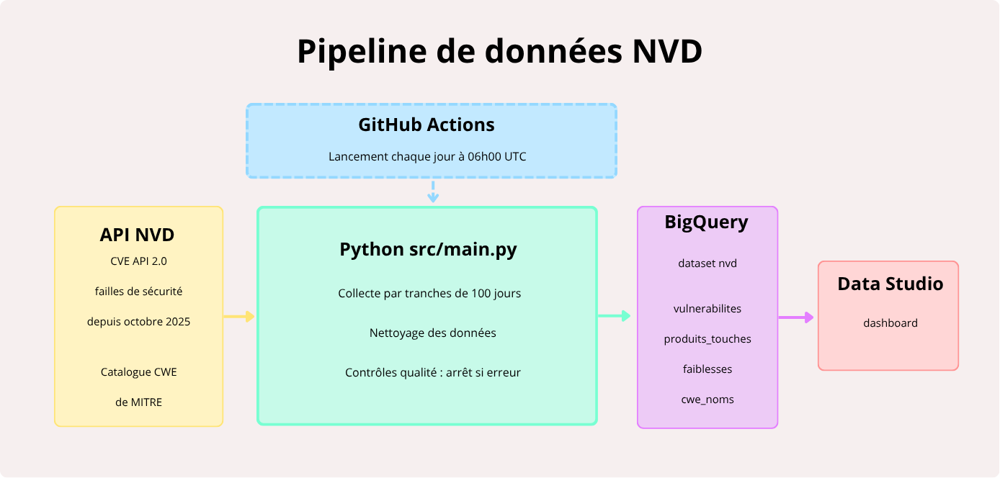

# Pipeline NVD vers Data Studio

Ce projet récupère chaque jour les failles de sécurité publiées dans la base nationale américaine NVD. Il les nettoie puis les charge dans BigQuery. Un tableau de bord Data Studio les présente à un client fictif.

Projet individuel réalisé à Simplon Lyon (formation Data Analyst) dans le cadre du brief « De l'API au tableau de bord ».

**Dashboard.** [Lien bientôt disponible]

## Sommaire

1. [Cas d'usage](#1-cas-dusage)
2. [Architecture](#2-architecture)
3. [Structure du dépôt](#3-structure-du-dépôt)
4. [Installation](#4-installation)
5. [Exécution](#5-exécution)
6. [Automatisation](#6-automatisation)
7. [Les données](#7-les-données)
8. [Le dashboard](#8-le-dashboard)
9. [Limites connues](#9-limites-connues)
10. [Évolutions possibles](#10-évolutions-possibles)
11. [Sources et mentions](#11-sources-et-mentions)

## 1. Cas d'usage

**Le client.** Yggdrasil Systems est une entreprise fictive. Son équipe informatique doit suivre les failles de sécurité qui concernent ses logiciels. Les consulter une par une sur le site du NVD n'est pas réaliste car il en paraît plusieurs milliers par semaine.

**Le besoin.** Une vue d'ensemble mise à jour chaque jour sans intervention humaine. Elle doit répondre à cinq questions.

| Page | Question | Ce que la page montre |
|---|---|---|
| 1. Vue d'ensemble | Où en est-on ? | Volume de failles par semaine et par mois, répartition par gravité et par note |
| 2. Attaques | Comment nous attaque-t-on ? | Origine de l'attaque, compte nécessaire, action de la victime, part des failles faciles à exploiter |
| 3. Types de défaut | Pourquoi ces failles existent-elles ? | Types de défaut les plus fréquents, gravité par type, impact sur les données et le service |
| 4. Éditeurs | Qui est touché ? | Éditeurs et produits qui concentrent le plus de failles |
| 5. Recommandations | Que faire ? | Constats chiffrés et une recommandation par constat |

**La solution.** Un pipeline Python collecte les données via l'API du NVD. Il les contrôle puis les charge dans BigQuery. GitHub Actions le lance tous les jours. Data Studio lit une vue SQL construite sur les tables.

## 2. Architecture



```
API NVD (failles)  ─┐
                    ├─> Python (collecte, nettoyage, contrôles) ─> BigQuery (4 tables + 1 vue) ─> Data Studio
Catalogue MITRE    ─┘                       ^
(noms des défauts)                          |
                                  GitHub Actions (tous les jours à 06h00 UTC)
```

**Les quatre étapes du script** (`src/main.py`)

1. **Collecte** (`src/collecte.py`). L'API accepte 120 jours maximum par requête et 2 000 failles par page. Le script découpe la période en tranches de 100 jours et lit toutes les pages. Il attend 6 secondes entre deux appels pour respecter les limites du NVD. En cas d'erreur temporaire (délai dépassé, codes 403, 429 ou 5xx) il réessaie avec une attente de plus en plus longue.
2. **Transformation** (`src/transformation.py`). Chaque fiche est transformée en lignes pour trois tables. Les failles rejetées sont retirées. Seule la note CVSS 3.1 est gardée. L'éditeur est mis en minuscules. Les valeurs manquantes deviennent « non renseigné » ou « non précisé ». Les noms des types de défaut viennent du catalogue CWE de MITRE.
3. **Contrôles qualité** (`transformation.controler_tables`). Une erreur arrête le pipeline avant tout chargement. Les tables BigQuery existantes restent alors intactes. La liste complète est dans [`docs/controles_qualite.md`](docs/controles_qualite.md).
4. **Chargement** (`src/chargement_bigquery.py`). Chaque table est supprimée puis recréée avec son schéma et sa description. Le script vérifie ensuite que le nombre de lignes et le nombre de scores vides sont identiques dans BigQuery.

**Pourquoi on recharge tout à chaque exécution.** Le projet BigQuery est un bac à sable gratuit. Il n'autorise ni `INSERT` ni `UPDATE` ni `MERGE`. On ne peut donc pas ajouter les nouvelles failles à une table existante. Le script retélécharge toute la période et remplace les tables. C'est simple et fiable pour ce volume (environ 95 000 failles). Une exécution complète dure environ 17 minutes.

**La vue `v_failles_detail`** (`sql/00_vue_failles_detail.sql`). Elle joint les quatre tables pour que tous les filtres de Data Studio fonctionnent sur toutes les pages. Une faille y apparaît sur plusieurs lignes (une par produit et par type de défaut). Deux colonnes d'aide permettent de compter sans doublon.

- `premiere_ligne` vaut 1 sur une seule ligne par faille. Le nombre de failles est `SUM(premiere_ligne)`.
- `score_faille` contient le score sur cette même ligne seulement. Le score moyen est `AVG(score_faille)`.

## 3. Structure du dépôt

```
.
├── .github/workflows/workflows.yml   Automatisation quotidienne
├── src/
│   ├── main.py                      Point d'entrée du pipeline
│   ├── collecte.py                  API du NVD et catalogue MITRE
│   ├── transformation.py            Nettoyage et contrôles qualité
│   └── chargement_bigquery.py       Envoi vers BigQuery
├── sql/
│   ├── 00_vue_failles_detail.sql    Vue utilisée par Data Studio
│   ├── 01_failles_par_mois_et_gravite.sql
│   ├── 02_profil_attaque_facile_par_mois.sql
│   ├── 03_top10_types_de_defaut.sql
│   └── 04_top10_editeurs.sql
├── notebooks/                       Exploration de l'API et du CSV complet
├── docs/
│   ├── schema_pipeline.png          Schéma du pipeline
│   ├── description_donnees.md       Tables, colonnes et règles de nettoyage
│   ├── controles_qualite.md         Contrôles et exemple de rapport
│   └── preuves/                     Captures de l'exécution automatique
├── requirements.txt
└── README.md
```

## 4. Installation

**Ce qu'il faut avoir**

- Python 3.12 ou plus récent
- Un projet Google Cloud avec BigQuery activé (le bac à sable gratuit suffit)
- Un compte de service avec les rôles « Éditeur de données BigQuery » et « Utilisateur de job BigQuery »

**Étapes**

1. Cloner le dépôt.

```bash
git clone https://github.com/LudivineThinet/pipeline-nvd-vulnerabilites.git
cd pipeline-nvd-vulnerabilites
```

2. Créer un environnement virtuel et installer les dépendances.

```bash
python -m venv .venv
source .venv/bin/activate        # Windows : .venv\Scripts\activate
pip install -r requirements.txt
```

3. Créer une clé JSON pour le compte de service dans la console Google Cloud. La ranger **hors du dépôt**.

4. Créer un fichier `.env` à la racine du dépôt (ou dans un dossier au-dessus).

```
GOOGLE_APPLICATION_CREDENTIALS=C:/chemin/vers/la/cle-google.json
PROJET_GCP=pipeline-nvd-vulnerabilites
DATASET_BQ=nvd
```

Seule la première ligne est obligatoire. Les deux autres ont les valeurs ci-dessus par défaut.

5. Créer le dataset `nvd` dans BigQuery en région **EU** s'il n'existe pas.

**Aucun secret n'est versionné.** Le fichier `.gitignore` bloque `.env` et les fichiers `*.json`. Il bloque aussi le dossier `data/`.

## 5. Exécution

**Exécution complète** (télécharge tout depuis le 1er octobre 2025 et charge BigQuery)

```bash
python src/main.py
```

Sous Windows la commande est `py src/main.py`.

**Essai rapide sans BigQuery** (écrit des CSV dans `data/sortie`)

```bash
python src/main.py --debut 2026-10-14 --fin 2026-10-15 --sans-chargement
```

**Options**

| Option | Rôle | Par défaut |
|---|---|---|
| `--debut AAAA-MM-JJ` | Premier jour à télécharger | 2025-10-01 |
| `--fin AAAA-MM-JJ` | Dernier jour à télécharger | maintenant |
| `--sans-chargement` | Écrit des CSV au lieu de charger BigQuery | désactivé |
| `--dossier-sortie` | Dossier des CSV de l'essai | `data/sortie` |

**Ce que le script affiche.** La période traitée puis le rapport de contrôles qualité (exemple dans [`docs/controles_qualite.md`](docs/controles_qualite.md)). Il affiche ensuite le nombre de lignes chargées dans chaque table. Avant de lancer le long téléchargement il vérifie la connexion à BigQuery. Une erreur de clé est donc détectée tout de suite.

**Créer la vue pour Data Studio** (une seule fois)

Ouvrir `sql/00_vue_failles_detail.sql` dans la console BigQuery et l'exécuter. La vue lit les tables à chaque requête et suit donc leurs mises à jour. Dans ce bac à sable une vue expire au bout de 60 jours. Il faudra la recréer avec la même requête.

**Brancher Data Studio.** Ajouter une source de données BigQuery qui pointe sur la vue `pipeline-nvd-vulnerabilites.nvd.v_failles_detail`.

## 6. Automatisation

Le fichier [`.github/workflows/workflows.yml`](.github/workflows/workflows.yml) lance le pipeline avec GitHub Actions.

| Déclencheur | Détail |
|---|---|
| Planifié | Tous les jours à 06h00 UTC |
| Manuel | Bouton « Run workflow » dans l'onglet Actions |

**Déroulement du job** (durée maximale 60 minutes)

1. Récupérer le code.
2. Installer Python 3.12 et les dépendances (avec cache).
3. Écrire la clé Google dans un fichier temporaire du serveur à partir du secret `GCP_SA_KEY`.
4. Lancer `python src/main.py`.

**La clé n'est jamais dans le code.** Elle est stockée dans le secret GitHub `GCP_SA_KEY` (Settings, Secrets and variables, Actions). Le fichier temporaire disparaît avec le serveur à la fin du job.

**Vérifier qu'une exécution a marché.** Ouvrir l'onglet Actions du dépôt. Une coche verte indique que le pipeline est allé au bout. Les logs montrent le rapport de contrôles qualité. Des captures d'exécutions réussies sont rangées dans [`docs/preuves/`](docs/preuves/).

**En cas d'échec.** GitHub envoie un e-mail. Les tables BigQuery restent celles de la dernière exécution réussie si l'échec vient d'un contrôle qualité. Une erreur pendant le chargement peut en revanche laisser une table vide. Dans ce cas il suffit de relancer le workflow à la main.

## 7. Les données

**Source des failles.** API NVD CVE 2.0 du NIST. **Source des noms de types de défaut.** Catalogue CWE de MITRE.

Quatre tables sont créées dans le dataset `nvd`.

| Table | Contenu | Lignes au 16 octobre 2026 |
|---|---|---|
| `vulnerabilites` | Une ligne par faille avec sa note CVSS 3.1 | 94 403 |
| `produits_touches` | Une ligne par faille et par produit | 195 178 |
| `faiblesses` | Une ligne par faille et par type de défaut | 109 458 |
| `cwe_noms` | Nom officiel de chaque type de défaut | 995 |

Le détail de chaque colonne et les règles de nettoyage sont dans [`docs/description_donnees.md`](docs/description_donnees.md). Ces chiffres changent à chaque exécution car le NVD publie et modifie des failles tous les jours.

## 8. Le dashboard

Le tableau de bord data Studio compte cinq pages (voir le tableau du cas d'usage). Un filtre de période et un filtre de gravité s'appliquent à toutes les pages.

Les requêtes de `sql/01` à `sql/04` ont servi à vérifier les chiffres du dashboard directement dans BigQuery.

**Définitions utilisées**

- **Faille facile à exploiter.** Faille exploitable à distance (origine `NETWORK`) sans compte (`NONE`) et sans action de la victime (`NONE`). La part est calculée parmi les failles qui ont une note.
- **Faille critique.** Gravité CVSS 3.1 `CRITICAL` (note de 9,0 à 10).
- **Compter les failles.** Une faille compte une seule fois même si elle touche plusieurs produits ou plusieurs types de défaut.

## 9. Limites connues

- **Bac à sable BigQuery.** Les tables et la vue expirent au bout de 60 jours. Chaque exécution quotidienne recrée les tables et repousse donc leur expiration. La vue doit être recréée à la main.
- **Un chargement complet par jour.** Faute de `MERGE` il n'y a pas de chargement incrémental.
- **Note CVSS 3.1 seulement.** Environ 10 % des failles n'ont pas de note 3.1. Elles comptent dans le volume mais pas dans les analyses de gravité.
- **Période de départ fixe.** La collecte commence toujours le 1er octobre 2025. La durée de téléchargement et le volume augmentent donc chaque jour.
- **Le mois en cours est incomplet.** Une baisse en fin de courbe ne veut pas dire que les failles diminuent.
- **« Facile à exploiter » vient de la note CVSS.** Cela mesure ce qu'il faut à l'attaquant. Cela ne dit pas que la faille a été exploitée dans la réalité.
- **Plusieurs types de défaut par faille.** La somme des failles par type dépasse le nombre total de failles.
- **Recommandations génériques.** Le client est fictif et son parc de logiciels n'est pas connu.

## 10. Évolutions possibles

- Remplacer la date de départ fixe par une **fenêtre glissante de 12 mois**.
- Faire créer la vue SQL par le pipeline pour ne plus l'exécuter à la main.
- Rendre le sous-titre du dashboard dynamique (il est écrit à la main).
- Sur un projet BigQuery avec facturation activée : charger seulement les failles modifiées depuis la dernière exécution (`MERGE`).
- Envoyer une alerte quand une faille critique touche un produit du parc du client.

## 11. Sources et mentions

- Les failles viennent de l'API NVD du NIST (https://nvd.nist.gov/developers/vulnerabilities). Ce projet utilise les données de l'API NVD mais n'est ni approuvé ni certifié par le NVD.
- Les noms des types de défaut viennent du catalogue CWE de The MITRE Corporation (https://cwe.mitre.org). CWE est une marque de The MITRE Corporation. Le catalogue est utilisé selon les conditions d'utilisation de CWE (https://cwe.mitre.org/about/termsofuse.html).
- Les scores de gravité suivent le standard CVSS 3.1 du FIRST.